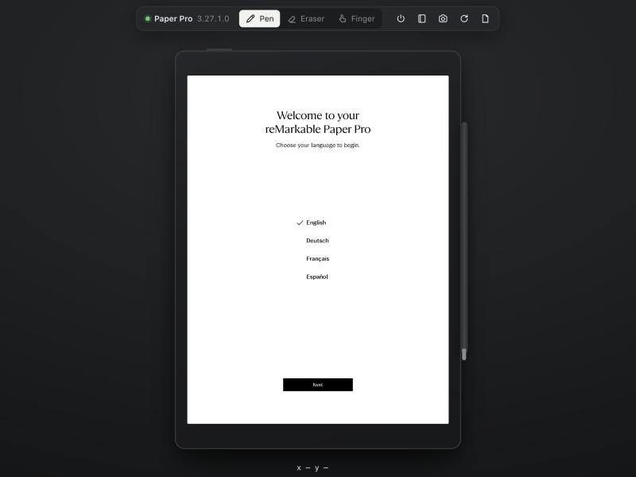
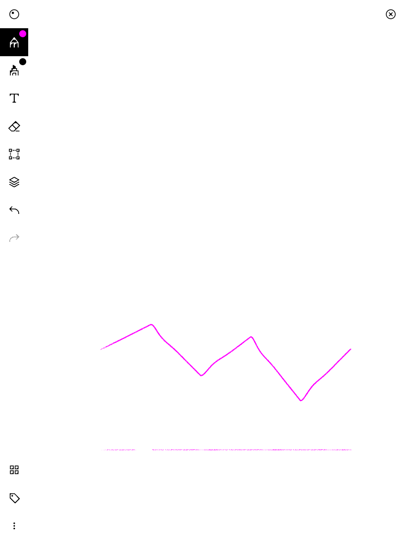
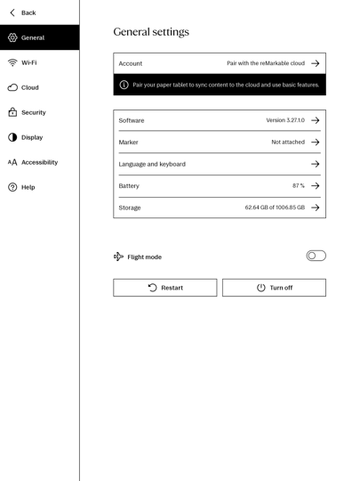

# rmemu: an unofficial reMarkable Paper Pro emulator

> **Disclaimer.** This is an independent, unofficial project. It is not affiliated with, endorsed by, or sponsored by reMarkable AS. "reMarkable", "Paper Pro", "Marker" and related logos are trademarks of reMarkable AS, used here only to identify the hardware this software works with. This repository contains no reMarkable software: `rmemu setup` downloads the official update package directly to your machine from public mirrors, and that software remains subject to reMarkable's license terms. The firmware, UI and artwork shown in screenshots are © reMarkable AS. Use at your own risk. Nothing here is meant to bypass account, cloud or licensing controls, and cloud sync is intentionally not supported.

Runs the **stock reMarkable Paper Pro OS** (firmware 3.27.1.0, `ferrari`) on your Mac, so you can try software changes before you ship them to the real tablet in developer mode.

There's no instruction-set emulation. The Paper Pro and Apple Silicon are both arm64, so the device's own root filesystem runs natively in a Docker container. A small preload library stands in for the hardware the OS expects: the e-ink controller, pen, touch, buttons, sensors and the secure key store. On top of that sit two front ends:

- **Simulator UI**: a browser window that shows the device the way the iOS Simulator does. You draw with the pen, tap with a finger, press power, dock the Marker and close the Folio.
- **Harness CLI**: `bin/rmemu` drives the same device from scripts or an AI agent. It takes screenshots, taps, swipes, draws strokes, waits for the screen to settle, opens a shell, copies files in and out, and restarts xochitl.

## Screenshots



| Pen + eraser in a notebook | Settings |
|---|---|
|  |  |

Captured from the stock OS running in the emulator (UI © reMarkable AS).

## Quick start

You need Docker Desktop and Node 20 or newer, on an Apple Silicon Mac (or any arm64 Linux machine).

```bash
bin/rmemu start        # first run downloads the firmware (~200 MB) and builds the image
bin/rmemu open         # simulator UI at http://127.0.0.1:7777
bin/rmemu skip-setup   # optional: skip the first-boot onboarding
```

On a fresh device the OS starts in first-boot onboarding: choose a language, skip Wi-Fi, dock the Marker (click the pen beside the device), and so on. Device data persists across restarts in the `rmemu-home` and `rmemu-data` Docker volumes. `rmemu reset` wipes them (a factory reset).

## Simulator UI

| | |
|---|---|
| **Pen / Eraser / Finger** (P / E / F) | Pen and eraser go to the digitizer, with pressure and tilt if you're using a real stylus; Finger goes to the touchscreen. Hold ⌥ in Finger mode to pinch: a second finger mirrors yours, iOS-Simulator style. |
| Power | The power key, also on the top edge of the device. It sleeps and wakes the tablet. |
| Folio | Closes or opens the cover (hall sensor). |
| Marker (beside the device) | Click it to attach or detach the Marker. Attaching docks and charges it, through the real `marker-manager`. |
| Screenshot (⌘S) | Saves the current screen as a PNG at full resolution. |
| Restart | Restarts xochitl. |
| Paper tone | A rough approximation of how the color e-ink panel actually looks. |

The bottom bar shows the cursor position in device pixels, so you can copy coordinates straight into `rmemu tap`.

## Harness CLI

Coordinates are device pixels: portrait, 1620×2160, origin at top-left. Each input command returns once the screen has settled. "Settled" also covers e-ink refreshes that are still running, and the command reports whether anything changed.

```bash
rmemu screenshot shot.png --scale 0.5    # 810x1080; multiply by 2 for device coordinates
rmemu tap 810 1916                       # finger; --pen / --eraser for the Marker
rmemu longpress 300 400
rmemu swipe 1500 1000 200 1000
rmemu draw 300,700 500,600 700,800 --pressure 0.7
rmemu pinch 810 1080 200 500
rmemu power | folio close | marker dock | usb connect | battery 15
rmemu wait --idle 500
rmemu ssh 'cat /etc/os-release'          # like ssh root@10.11.99.1 on a dev-mode device
rmemu push ./my-app /home/root/my-app
rmemu restart [--debug]                  # --debug traces every hardware access in `rmemu logs`
rmemu logs -f
```

The server behind the UI also has an HTTP API for other tools: `GET /api/screenshot.png?scale=`, `POST /api/gesture`, `GET /api/wait`, `GET /api/status`, `GET /api/logs`. See [host/server.mjs](host/server.mjs).

## Developing for the tablet

The emulator behaves like a Paper Pro in developer mode:

- **SSH**: `rmemu ssh` (or `ssh -i .rmemu/id_ed25519 -p 2222 root@127.0.0.1`). The login shell is the device's own `rmdevlogin`.
- **systemctl**: `systemctl restart|stop|start xochitl` works as on the device (the entrypoint supervises it).
- **Hardware nodes**: every process, including SSH shells, sees the same fake `/sys` and `/dev/input` nodes. `cat /sys/class/power_supply/max1726x_battery/capacity` works, and an app that reads `/dev/input/event*` directly gets live pen and touch events.
- **Same binaries**: xochitl, its Qt plugins and the libraries are byte-for-byte the shipped ones, so hooks and extensions built against 3.27.1.0 meet the same code.

To test a different firmware: `rmemu versions` lists them and `rmemu start <version>` boots that one. Match the version your tablet runs (Settings → General → Software).

## How it works

```
 Mac                                  container (stock Paper Pro rootfs, linux/arm64)
┌──────────────────────┐   :8888    ┌───────────────────────────────────────────────┐
│ host/server.mjs      │◀──────────▶│ rmemud   input hub · display relay · uevents  │
│  · simulator UI (WS) │            │   ▲ display.sock          input.sock ▼        │
│  · HTTP API          │            │ xochitl ── rmemu-shim.so (via ld.so.preload)  │
│ bin/rmemu (CLI)      │   :2222    │   fake DRM for SWTCON · framebuffer capture   │
│                      │◀── ssh ───▶│   evdev · udev · sd_device · libiio · sysfs   │
└──────────────────────┘            │   PKCS#11 soft token · RT-priority shims      │
                                    │ marker-manager · dbus · dropbear              │
                                    └───────────────────────────────────────────────┘
```

- **Firmware**: `rmemu setup` downloads the `.swu` update package and checks its sha256, using the community version index from [codexctl](https://github.com/Jayy001/codexctl). [tools/import-rootfs.sh](tools/import-rootfs.sh) unpacks the ext4 root filesystem with `debugfs`, with no root access or privileged container, and imports it as `rmpp-rootfs:<version>`. [docker/Dockerfile](docker/Dockerfile) layers the emulator on top.
- **Display** ([shim/drm.c](shim/drm.c), [shim/fb.c](shim/fb.c)): xochitl drives the panel itself through SWTCON, a software e-ink timing controller, over atomic KMS on `/dev/dri/card0`. The shim provides that KMS device with the panel's real scanout mode (405×1084, packed waveform phases) and paces the flips at 85 Hz. It captures the 1620×2160 RGB32 image xochitl renders into, and sends only the regions that changed.
- **Input** ([shim/input.c](shim/input.c), [daemon/rmemud.c](daemon/rmemud.c)): there are fake evdev devices for the Elan pen and touchscreen, the power key and the hall sensors. rmemud fans events out to every process that opens them. [shim/udev.c](shim/udev.c) lets Qt find them, and [shim/sddevice.c](shim/sddevice.c) carries power_supply uevents for Marker docking and USB charging.
- **Everything else** xochitl insists on is in [shim/](shim/): a software PKCS#11 token replacing OP-TEE's `user-token` and `device-token`, the `lis2dw12` orientation sensor ([shim/iio.c](shim/iio.c)), a sysfs tree under [docker/root/](docker/root/) (battery, charger, temperature sensor, device-tree display info, secure boot reported as unlocked), and faked realtime thread priority.

## Not emulated (yet)

- **E-ink rendering**: the screen shows the final image right away. You won't see the refresh flash, ghosting, or the panel's muted colors (Paper tone only approximates the colors).
- **Network and cloud**: there's no Wi-Fi, and the soft token's device key isn't registered with reMarkable, so sync and pairing won't work.
- **Rotation**: the orientation sensor exists but doesn't send events yet.
- **Type Folio keyboard and Bluetooth.**
- **Intel Macs**: they would need QEMU user-mode emulation, which is much slower.

## Reference: the real device

| | |
|---|---|
| Codename | `ferrari` (Paper Pro Move is `chiappa`) |
| SoC | NXP i.MX 8M Mini, 4× Cortex-A53 (aarch64) |
| Display | 11.8" Canvas Color e-ink, 1620×2160, 229 ppi |
| OS | reMarkable OS ("Codex", Yocto scarthgap), UI is `xochitl` (Qt 6.8) |
| Developer mode | Settings → General → Paper Tablet → Software → Advanced → Developer Mode (**factory resets** the tablet, so sync first). The root password is under Settings → General → Help → About → Copyrights and Licenses. `ssh root@10.11.99.1` over USB. |

Device facts and developer-mode steps come from reMarkable's public documentation. The firmware version index comes from [codexctl](https://github.com/Jayy001/codexctl) (GPL-3.0), fetched at a pinned commit at setup time.

Links: [developer mode](https://developer.remarkable.com/documentation/developer-mode) · [SDK](https://developer.remarkable.com/documentation/sdk) · [kernel (`ferrari_defconfig`)](https://github.com/reMarkable/linux-imx-rm) · [codexctl](https://github.com/Jayy001/codexctl)

## License

MIT, see [LICENSE](LICENSE). The license covers this repository's code only. It grants no rights in reMarkable's firmware or other software.
